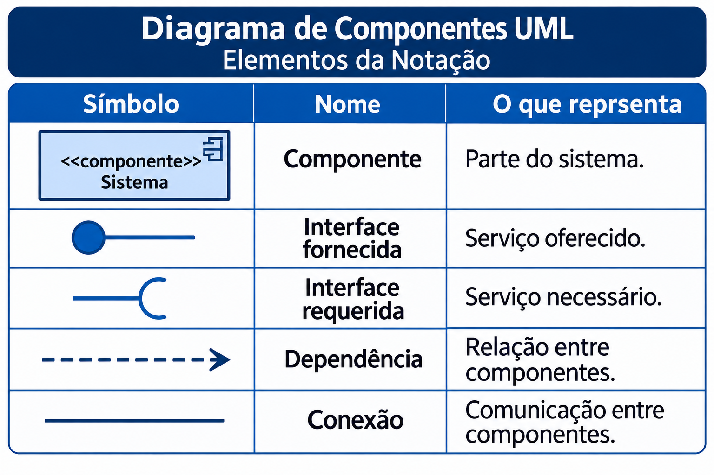

# Diagrama de Componentes

**Grupo 3:** Felipe Velarde Hurtado Junior

> Apague as instruções entre colchetes e preencha cada seção.

## Definição

[O que é o diagrama e para que serve.]

O diagrama de componentes UML representa as partes de um sistema e suas dependências.
Serve para: mostrar como os componentes se organizam e se comunicam.

## Quando usar

[Em que fase ou contexto do projeto ele é mais útil.]

Usado para visualizar a estrutura de um sistema e como seus componentes se conectam, facilitando o desenvolvimento e a manutenção.

## Elementos da notação

| Símbolo | Nome | O que representa |
|---|---|---|
| [descrição ou imagem] | [nome] | [significado] |

Símbolo Nome O que representa

Retângulo com ícone de componente Componente Parte do sistema

Círculo (bolinha) Interface fornecida Serviço oferecido

Semicírculo Interface requerida Serviço necessário

Linha tracejada com seta Dependência Relação entre componentes

## Exemplo prático

[Explique em poucas linhas o sistema escolhido e o que o diagrama mostra.]

Sistema escolhido: Sistema de Cinema
O diagrama mostra os componentes do sistema de cinema, como compra de ingressos, pagamento e seleção de assentos, e como eles se comunicam para realizar a compra.

## Comparação com Caso de Uso, Classe e Sequência

[Em que este diagrama se parece com eles e em que se diferencia.]

Semelhança: Todos representam partes do sistema e ajudam a entender seu funcionamento.

Diferença: O diagrama de componentes mostra a estrutura do sistema; o de caso de uso mostra as funcionalidades, o de classes mostra as classes e o de sequência mostra a ordem das interações.

## Apresentação

[Apresentação em PDF](apresentacao.pdf)

## Referências

- [Livros, artigos ou sites consultados.]
  
Livros
- BOOCH, Grady; RUMBAUGH, James; JACOBSON, Ivar. UML: Guia do Usuário. Elsevier.
- 
Sites consultados
Object Management Group (OMG) — Especificação UML⁠
IBM — Diagramas de Componentes⁠
Microsoft — Criar um Diagrama de Componentes UML⁠

Artigo
- BELL, Donald. The Component Diagram. IBM Developer. Acessar artigo⁠
